  

   

  
  
  
  

 

<table>
  <tr>
    <td width="34%" align="center" valign="middle">
      
    </td>
    <td width="66%" valign="middle">
      
<code>FULL-STACK DEVELOPER · SRI LANKA</code>

      <h2>Building thoughtful, high-performance digital experiences.</h2>
      

        I'm <strong>Yesith S. Hansana</strong>. I turn ambitious ideas into polished products—pairing
        responsive interfaces with reliable backend systems, clean architecture, and careful details.
      

      

        <a href="https://www.hansana.dev/"><strong>Explore my portfolio →</strong></a>
        &nbsp;·&nbsp;
        <a href="https://github.com/yesith-sri?tab=repositories"><strong>View my work →</strong></a>
      

    </td>
  </tr>
</table>

## A little more about me

<table>
  <tr>
    <td width="50%" valign="top">
      <h3>01 / What I'm building</h3>
      
Web applications with clean architecture, considered user experiences, and dependable APIs.

    </td>
    <td width="50%" valign="top">
      <h3>02 / What I'm exploring</h3>
      
Advanced Spring Boot, Angular, cloud-native systems, and practical AI integrations.

    </td>
  </tr>
  <tr>
    <td width="50%" valign="top">
      <h3>03 / Let's collaborate</h3>
      
Open-source tools, full-stack products, backend platforms, and creative software solutions.

    </td>
    <td width="50%" valign="top">
      <h3>04 / Ask me about</h3>
      
Web development, REST APIs, Java ecosystems, and software architecture best practices.

    </td>
  </tr>
</table>

  
  
  

 

## Technology toolbox

<table>
  <tr>
    <td align="center" width="25%"><strong>Frontend</strong></td>
    <td align="center" width="25%"><strong>Backend</strong></td>
    <td align="center" width="25%"><strong>Data &amp; DevOps</strong></td>
    <td align="center" width="25%"><strong>Workflow</strong></td>
  </tr>
  <tr>
    <td align="center" valign="top">
       
      
    </td>
    <td align="center" valign="top">
       
      
    </td>
    <td align="center" valign="top">
       
      
    </td>
    <td align="center" valign="top">
       
      
    </td>
  </tr>
</table>

 

## Developer analytics

  

  
  

  
  

  
<strong>How to read this dashboard</strong>

   
  

    The score card summarizes public commits, pull requests, issues, reviews, stars, and contributions.
    Language percentages describe repository code volume, not personal proficiency. Some cards are cached,
    so today's activity can take a little while to appear.
  

 

## Contribution journey

  <picture>
    <source media="(prefers-color-scheme: dark)" srcset="https://raw.githubusercontent.com/yesith-sri/yesith-sri/output/github-snake-dark.svg" />
    <source media="(prefers-color-scheme: light)" srcset="https://raw.githubusercontent.com/yesith-sri/yesith-sri/output/github-snake.svg" />
    
  </picture>

 

  <code>DESIGN WITH INTENT · ENGINEER WITH CARE · KEEP SHIPPING</code>
    
  <a href="https://www.hansana.dev/"><strong>hansana.dev</strong></a>

