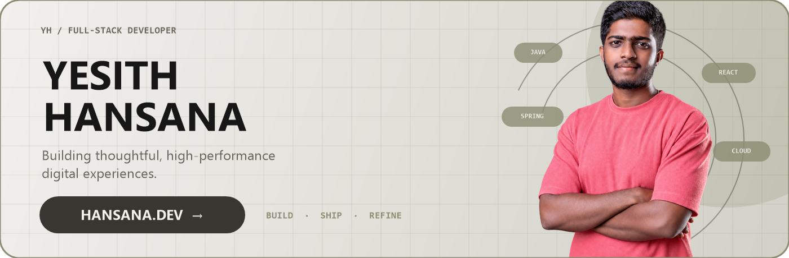

  

   

  
  
  
  

 

  
<code>FULL-STACK DEVELOPER · SRI LANKA</code>

  

    I turn ambitious ideas into polished products—pairing responsive interfaces with reliable
    backend systems, clean architecture, and careful details.
  

  

    <a href="https://www.hansana.dev/"><strong>Explore hansana.dev →</strong></a>
    &nbsp;·&nbsp;
    <a href="https://github.com/yesith-sri?tab=repositories"><strong>View my work →</strong></a>
  

## A little more about me

<table>
  <tr>
    <td width="50%" valign="top">
      <h3>01 / What I'm building</h3>
      
Web applications with clean architecture, considered user experiences, and dependable APIs.

    </td>
    <td width="50%" valign="top">
      <h3>02 / What I'm exploring</h3>
      
Advanced Spring Boot, Angular, cloud-native systems, and practical AI integrations.

    </td>
  </tr>
  <tr>
    <td width="50%" valign="top">
      <h3>03 / Let's collaborate</h3>
      
Open-source tools, full-stack products, backend platforms, and creative software solutions.

    </td>
    <td width="50%" valign="top">
      <h3>04 / Ask me about</h3>
      
Web development, REST APIs, Java ecosystems, and software architecture best practices.

    </td>
  </tr>
</table>

  
  
  

 

## Technology toolbox

### Languages &amp; backend

<table>
  <tr>
    <td width="8%"><code>01</code></td>
    <td>
      <strong>Java, C/C++, C#, .NET, Python, Go</strong>
        
      
    </td>
  </tr>
  <tr>
    <td><code>02</code></td>
    <td>
      <strong>JavaScript, TypeScript, Node.js, Bun, Express</strong>
        
      
    </td>
  </tr>
  <tr>
    <td><code>03</code></td>
    <td>
      <strong>Spring Boot, Swagger, Zod, REST APIs</strong>
        
      &nbsp;&nbsp;
      &nbsp;&nbsp;
      &nbsp;&nbsp;
      
    </td>
  </tr>
</table>

### Frontend

<table>
  <tr>
    <td width="8%"><code>01</code></td>
    <td>
      <strong>React, Next.js, TanStack</strong>
        
      &nbsp;&nbsp;
      
    </td>
  </tr>
  <tr>
    <td><code>02</code></td>
    <td>
      <strong>Angular, Tailwind CSS, Bootstrap</strong>
        
      
    </td>
  </tr>
  <tr>
    <td><code>03</code></td>
    <td>
      <strong>HTML5, CSS3</strong>
        
      
    </td>
  </tr>
</table>

### Data, cloud &amp; tooling

<table>
  <tr>
    <td width="8%"><code>01</code></td>
    <td>
      <strong>MySQL, PostgreSQL, Neon DB, Redis, Firebase</strong>
        
      &nbsp;&nbsp;
      
    </td>
  </tr>
  <tr>
    <td><code>02</code></td>
    <td>
      <strong>Flyway, Liquibase, DBeaver, Docker, Kubernetes, Linux, ngrok, MobaXterm</strong>
        
      &nbsp;&nbsp;
      &nbsp;&nbsp;
      &nbsp;&nbsp;
      &nbsp;&nbsp;
      &nbsp;&nbsp;
      
    </td>
  </tr>
  <tr>
    <td><code>03</code></td>
    <td>
      <strong>Google Cloud, AWS, Tigris S3, Vercel, Git, GitHub, GitLab</strong>
        
      &nbsp;&nbsp;
      
    </td>
  </tr>
  <tr>
    <td><code>04</code></td>
    <td>
      <strong>IntelliJ IDEA, VS Code, WebStorm, npm, Jira</strong>
        
      &nbsp;&nbsp;
      
    </td>
  </tr>
</table>

 

## Developer analytics

  

  
  

  
  

  
<strong>How to read this dashboard</strong>

   
  

    The dashboard summarizes public commits, pull requests, issues, reviews, stars, and contributions.
    Language percentages describe repository code volume, not personal proficiency. Cards are cached,
    so today's activity can take a little while to appear.
  

 

## Contribution journey

  <picture>
    <source media="(prefers-color-scheme: dark)" srcset="https://raw.githubusercontent.com/yesith-sri/yesith-sri/output/github-snake-dark.svg" />
    <source media="(prefers-color-scheme: light)" srcset="https://raw.githubusercontent.com/yesith-sri/yesith-sri/output/github-snake.svg" />
    
  </picture>

 

  <code>DESIGN WITH INTENT · ENGINEER WITH CARE · KEEP SHIPPING</code>
    
  <a href="https://www.hansana.dev/"><strong>hansana.dev</strong></a>

